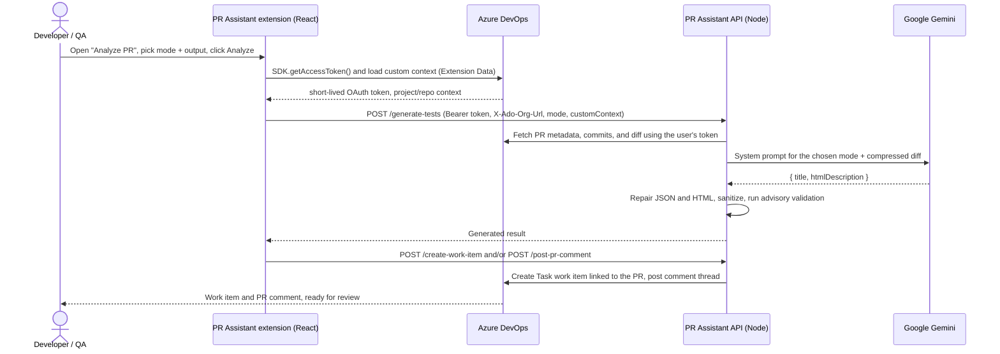

<a id="readme-top"></a>

<div align="center">


# PR Assistant

**AI-powered test cases and code reviews from real pull-request diffs, native to Azure DevOps.**

[](https://marketplace.visualstudio.com/items?itemName=QAZent.pr-assistant-extension-qazent)
[](LICENSE)
[](package.json)
[](tsconfig.json)
[](package.json)
[](#contributing-guide)

[Website](https://qazent.com) · [Marketplace listing](https://marketplace.visualstudio.com/items?itemName=QAZent.pr-assistant-extension-qazent) · [Key features](#key-features) · [How it works](#how-it-works) · [Contributing](#contributing-guide) · [Roadmap](#roadmap) · [Security](#security--safety)


</div>

---

PR Assistant is the Azure DevOps extension built by [QAZent](https://qazent.com). Open a pull request, click **Analyze**, and get structured test cases or a code review generated from the real diff, delivered as an Azure Boards work item and/or a PR comment. This repository contains the complete source for both the extension UI and the API that powers it.

We open-sourced it so that anyone can see exactly what data leaves their organization and how it is handled, so QA and engineering teams can shape the output they rely on, and so the Azure DevOps community has a real-world, production-grade extension to learn from and build on. The hosted service and the Marketplace listing remain operated by QAZent; see [Governance & Deployment](#governance--deployment).

## Table of Contents

- [What is PR Assistant?](#what-is-pr-assistant)
- [Key Features](#key-features)
- [How It Works](#how-it-works)
  - [Two coordinated parts](#two-coordinated-parts)
  - [The Analyze flow](#the-analyze-flow)
  - [Main components](#main-components)
  - [Repository layout](#repository-layout)
  - [Tech stack](#tech-stack)
- [Using the Extension](#using-the-extension)
- [Development Setup](#development-setup)
- [Testing](#testing)
- [Contributing Guide](#contributing-guide)
- [Security & Safety](#security--safety)
- [Governance & Deployment](#governance--deployment)
- [Roadmap](#roadmap)
- [FAQ](#faq)
- [Community & Support](#community--support)
- [License](#license)
- [Acknowledgements](#acknowledgements)

## What is PR Assistant?

**What it does.** PR Assistant adds an **Analyze PR** tab to every pull request in Azure Repos. From there you choose a mode and an output format, and the extension turns the PR's diff, title, description, commit messages, and optional team context into:

- **QA mode**: structured test cases with purpose, scope, preconditions, test steps with expected results, negative scenarios and edge cases, regression areas, data requirements, and automation notes.
- **Code Review mode**: actionable findings, highest-risk areas, and an overall verdict (approve / approve with comments / request changes).
- **Deep Technical Review mode**: a staff-engineer-style pass focused on low-level correctness (null safety, concurrency, resource handling, error handling, boundary cases, input validation) that quotes the offending code and proposes concrete improvements.

Results land where your team already works: as a work item linked back to the PR with a summary comment, or as the full output posted directly as a PR comment.

**Why it exists.** Most AI review tools are review-first, want broad repository permissions or full-repo indexing, and bolt onto Azure DevOps rather than living inside it. QA teams were left writing test documentation by hand, after the fact. PR Assistant takes the opposite stance: QA-first, diff-only, authenticated with the signed-in user's own token, and set up in minutes with no pipelines, YAML, service accounts, or elevated permissions.

**Who it's for.**

- QA engineers and test leads who want consistent, traceable test assets for every PR.
- Developers who want a structured second pair of eyes before requesting review.
- Teams in security-conscious environments who need to know precisely what an AI tool can see.
- Contributors interested in Azure DevOps extensions, LLM prompt engineering, or TypeScript/Node services.

**Project status.** Stable and in production on the Azure DevOps Marketplace, with versioned releases. The codebase is actively maintained by QAZent, and community contributions are welcome.

<p align="right"><a href="#readme-top">back to top</a></p>

## Key Features

- **Three analysis modes** (QA, Code Review, Deep Technical Review) so one extension fits both QA and engineering workflows.
- **Flexible output**: work item plus summary PR comment (default), or the full result as a PR comment only.
- **Analysis from real diffs**, powered by Google Gemini, using the PR diff, metadata, and commit history rather than guesses.
- **Smart diff compression**: files are ranked by path, extension, and change size so large PRs stay within the model's budget while keeping what matters.
- **Project and repository custom context** so the AI applies the same business rules, conventions, and risk hotspots your team would.
- **Traceable work items**: generated items are tagged `AI-Generated` and linked to the PR via an artifact link.
- **Privacy-first processing**: diff-level data only, processed in memory per request, never stored permanently, never used to train models.
- **Hardened API**: per-route rate limiting, Azure DevOps token validation on every request, HTML sanitization before anything is written back to Azure DevOps.
- **Optional durable queue** (Upstash Redis + worker) for asynchronous processing, and a license subsystem backed by Lemon Squeezy with optional Postgres persistence.

<p align="right"><a href="#readme-top">back to top</a></p>

## How It Works

### Two coordinated parts

| Part | Where it runs | What it does |
|------|---------------|--------------|
| **Extension UI** (`src/`) | Inside Azure DevOps, in the user's browser | Three contributions declared in `vss-extension.json`: the **Analyze PR** tab on pull requests, the **QAZent - AI Context Settings** project-admin hub, and the **QAZent - License** project-admin hub. Built with React 18 and Fluent UI v9 on top of `azure-devops-extension-sdk`. |
| **API** (`src/backend/`) | A Node.js HTTP service (QAZent hosts the production instance at `api.qazent.com`) | Validates the caller's Azure DevOps OAuth token, fetches PR data with that token, builds a token-bounded prompt, calls Google Gemini, repairs and sanitizes the response, and creates work items and PR comments on the user's behalf. |

The extension never holds long-lived credentials. Every API call carries the signed-in user's short-lived OAuth token (`Authorization: Bearer`) plus the organization URL (`X-Ado-Org-Url`), and the API acts strictly within that user's permissions.

### The Analyze flow



Nothing is changed in your code: PR Assistant only creates work items and comments, and every result is reviewable before anyone acts on it.

### Main components

| Area | Path | Responsibility |
|------|------|----------------|
| PR tab | `src/hub/`, `src/index.tsx` | `PRAssistantHub` orchestrates license check, context loading, mode/output selection, and the generate → create → comment pipeline. |
| Settings hub | `src/settings/` | Project-default and per-repository custom context, stored in Azure DevOps Extension Data (collection `ai-contexts`). |
| License hub | `src/license/` | License status and activation UI. |
| Extension services | `src/services/` | `backendClient` (typed HTTP client, URL validation, token caching), `configService`, `webhookService`. |
| HTTP server | `src/backend/server.ts` | Routing, CORS allowlist, rate limiting, authentication, audit logging. Middleware order is rate limit → auth → audit → handler. |
| Middleware | `src/backend/middleware/` | `authenticate.ts` validates Azure DevOps tokens; `rateLimiter.ts` applies per-route limits. |
| Azure DevOps client | `src/backend/ado-client.ts`, `fetchPRdiff.ts` | Diff and metadata retrieval, unified diff generation, work item creation, PR comments, artifact links. |
| AI layer | `src/backend/ai.ts`, `diff-config.ts`, `services/geminiRunner.ts` | Prompt construction and compression, Gemini calls, short-prompt retry, JSON extraction. |
| Output hygiene | `src/backend/utils/repair-html.ts`, `sanitize-html.ts`, `extract-json.ts` | Repairs malformed model output (especially code blocks) and sanitizes HTML before it is persisted. |
| Redis queue | `src/backend/queue/`, `src/backend/worker/` | Optional durable job pipeline behind `POST /api/queue/pr`, with locking and idempotency. |
| Licensing | `src/backend/license/` | Lemon Squeezy API and webhooks, hashed license keys, in-memory or Postgres store. |
| System prompts | `system-prompt.txt`, `system-prompt-review.txt`, `system-prompt-deep-review.txt` | One prompt per mode; copied next to the compiled backend at build time. |

<details>
<summary><strong>HTTP API reference (the contract between extension and backend)</strong></summary>

<br />

Unless noted, endpoints expect `Content-Type: application/json`, `Authorization: Bearer <Azure DevOps OAuth token>`, and `X-Ado-Org-Url: <organization URL>`.

| Method | Path | Auth | Purpose |
|--------|------|------|---------|
| GET/HEAD | `/`, `/health` | Public | Liveness: `status`, `uptime`, `timestamp`. |
| POST | `/generate-tests` | Yes | Body: `prId`, `projectName`, `repositoryId`, `mode` (`qa` / `review` / `deep-review`), optional `customContext` (max 3000 characters). Returns `title`, `htmlDescription`, commit IDs, optional compression report. |
| POST | `/create-work-item` | Yes | Creates a Task work item from a generated result and links it to the PR. |
| POST | `/post-pr-comment` | Yes | Posts a PR comment thread (work item link or full content). |
| POST | `/api/extract-purpose-scope` | Yes | Extracts the Purpose/Scope section from generated HTML for the summary comment. |
| POST | `/api/queue/pr` | Yes | Enqueues a Redis job; returns 503 when Redis is not configured. |
| GET | `/license/status` | Yes | License state for the calling organization and user. |
| POST | `/license/activate` | Yes | Activates a license key. |
| POST | `/webhooks/lemon-squeezy` | Public, signature-verified | Billing webhook from Lemon Squeezy. |

`POST /webhook` (the old service-hook auto-analyze path), `POST /api/webhook-token`, and the in-memory worker in `src/backend/queue.ts` are intentionally **disabled** and live inside commented blocks in `server.ts`. See the [FAQ](#faq) for why.

</details>

### Repository layout

```text
.
├── src/
│   ├── hub/                 # Analyze PR tab (webpack entry: hub)
│   ├── settings/            # AI Context Settings hub (webpack entry: settings)
│   ├── license/             # License hub (webpack entry: license)
│   ├── services/            # backendClient, configService, webhookService
│   ├── config/              # Frontend feature flags
│   ├── hooks/, types/       # Shared UI hooks and extension types
│   └── backend/             # Node API: server, middleware, AI, ADO client, queue, worker, license
├── tests/                   # Jest suites, fixtures, and Azure DevOps / Redis mocks
├── public/                  # Marketplace screenshots and GIFs
├── docs/                    # Design specs and feature investigations
├── scripts/                 # CI publish and VSIX manifest patch helpers
├── system-prompt*.txt       # Gemini system prompts (one per mode)
├── vss-extension.json       # Extension manifest: contributions, scopes, Marketplace metadata
├── overview.md, pricing.md, privacy-policy.md, license-terms.md   # Marketplace listing content
├── webpack.config.js        # Extension bundles -> dist/ (clean: false, backend output lives there too)
├── tsconfig.backend.json    # Backend compile -> dist/backend/
└── .rules                   # Repository conventions for humans and AI coding assistants
```

### Tech stack

| Layer | Technology |
|-------|------------|
| Language | TypeScript (strict mode) throughout |
| Extension UI | React 18, Fluent UI v9, `azure-devops-extension-sdk`, `azure-devops-extension-api` |
| Backend | Node.js 24.x, built-in `http` module, `azure-devops-node-api`, `@google/genai` |
| Build | Webpack 5 + `ts-loader` for the extension; `tsc` for the backend; `tfx-cli` for VSIX packaging |
| Data (optional) | Upstash Redis (`@upstash/redis`) for the job queue; Postgres (`pg`) for license persistence |
| Billing | Lemon Squeezy (license keys, webhooks) |
| Testing | Jest 30, `ts-jest`, Testing Library |
| CI | Azure Pipelines (`src/backend/utils/azure-pipelines.yml`): type-check, tests, build, package |

<p align="right"><a href="#readme-top">back to top</a></p>

## Using the Extension

If you just want to use PR Assistant in your organization, you do not need anything in this repository:

1. Install **PR Assistant** from the [Azure DevOps Marketplace](https://marketplace.visualstudio.com/items?itemName=QAZent.pr-assistant-extension-qazent).
2. Start the free trial or activate a license under **Project Settings → QAZent - License**.
3. Optionally add project and repository context under **Project Settings → QAZent - AI Context Settings**.
4. Open any pull request, switch to the **Analyze PR** tab, pick a mode and output option, and click **Analyze**.

Setup guides, pricing, FAQ, and the changelog live at [qazent.com](https://qazent.com). The Marketplace overview is in [`overview.md`](overview.md).

<p align="right"><a href="#readme-top">back to top</a></p>

## Development Setup

This section gets you from clone to a running API and a green test suite. You do **not** need an Azure DevOps organization, a license, or production credentials for most contributions.

### Prerequisites

| Requirement | Notes |
|-------------|-------|
| **Node.js 24.x** and **npm 11+** | Matches `engines` in `package.json` and the CI pipeline. |
| **Git** | Fork-and-branch workflow (see [Contributing](#contributing-guide)). |
| **Google Gemini API key** | Only needed to run the API or the local generation harness. A free key is available from [Google AI Studio](https://aistudio.google.com/app/apikey). Use a personal key; never a QAZent production key. |
| *(Optional)* Azure DevOps organization | A free org is enough for end-to-end UI testing. Use a throwaway project with synthetic PRs. |
| *(Optional)* `tfx-cli` | `npm install -g tfx-cli` to package a VSIX for sideloading. |
| *(Optional)* Upstash Redis / Postgres | Only if you work on the queue or license subsystems. |

### 1. Fork, clone, install

```bash
git clone https://github.com/<your-username>/test-extension.git
cd test-extension
npm ci
```

### 2. Configure environment

Create a `.env` file in the repository root (it is gitignored, and the server loads it automatically via `dotenv`). The minimal configuration is:

```bash
GEMINI_API_KEY=your-personal-gemini-key
PORT=3000
NODE_ENV=development
```

<details>
<summary><strong>All environment variables</strong></summary>

<br />

| Variable | Required | Purpose |
|----------|----------|---------|
| `GEMINI_API_KEY` | Yes (API and worker) | Google Gemini API key. The server refuses to start without it. |
| `PORT` | No | Listen port, default `3000`. |
| `NODE_ENV` | No | `development` additionally allows `localhost` and tunnel origins in CORS. |
| `NGROK_URL` | No | Extra allowed CORS origin in development. |
| `SERVICE_NAME`, `DEBUG` | No | Structured logger service name and verbosity. |
| `UPSTASH_REDIS_URL`, `UPSTASH_REDIS_TOKEN` | Queue only | Enables `POST /api/queue/pr` and the worker. |
| `DATABASE_URL` | License only | Postgres connection string for durable license state; in-memory store when unset. |
| `LICENSE_HASH_SALT` | License only | Salt for hashing license keys (raw keys are never stored). |
| `LEMON_SQUEEZY_API_KEY`, `LEMON_SQUEEZY_WEBHOOK_SECRET`, `LEMON_SQUEEZY_LICENSE_API_URL` | License only | Lemon Squeezy integration and webhook signature verification. |
| `LICENSE_DEFAULT_SEATS_PER_KEY`, `LICENSE_EXPIRY_GRACE_DAYS`, `LICENSE_ALLOWED_PRODUCT_IDS` | License only | License policy tuning. |
| `MOCK_MODE`, `ADO_ORG_URL`, `ADO_PAT` | Local harness only | Used by `npm run test:local`; the extension itself never sends a PAT. |

There is no committed `.env.example` yet; adding one is listed in the [Roadmap](#roadmap).

</details>

### 3. Build and run the API locally

```bash
npm run build:backend     # TypeScript -> dist/backend/, copies system prompts
npm start                 # node dist/backend/server.js
curl http://localhost:3000/health
```

> `npm run dev` currently points at a stale entry file; use the build-and-start flow above until that script is fixed (see [Roadmap](#roadmap)).

### 4. Run the checks you will need before every PR

```bash
npm run lint      # TypeScript type-check (tsc --noEmit)
npm test          # Jest suite
npm run build     # Extension bundles + backend, the same build CI runs
```

### 5. Exercise generation without Azure DevOps

```bash
# .env: MOCK_MODE=true
npm run test:local
```

This loads `tests/mock-pr.json`, uses mock diff data, calls Gemini with your key, prints the generated output, and skips work item creation.

<details>
<summary><strong>End-to-end testing inside a real Azure DevOps organization</strong></summary>

<br />

Only needed for UI or integration changes. Everything here happens in **your own** test organization and **your own** private Marketplace publisher; nothing touches QAZent's production listing.

1. Build the extension bundles in watch mode while you work: `npm run dev:extension` (outputs to `dist/`).
2. Expose your local API over HTTPS (Azure DevOps pages cannot call plain `http://localhost`), for example with [ngrok](https://ngrok.com): `ngrok http 3000`.
3. Create a local, **uncommitted** copy of `vss-extension.json` with your own `publisher` ID, `"public": false`, and a `backendUrl` property on each contribution pointing at your tunnel URL. `PRAssistantHub`, `SettingsHub`, and `LicensePanel` read `contribution.properties.backendUrl` and fall back to `https://api.qazent.com` when it is absent.
4. License gating is on by default (`src/config/featureFlags.ts` and the webpack `DefinePlugin`). For local testing you may flip it off in your working copy; do not commit that change.
5. Package with `npm run build && npm run package:extension` (requires `tfx-cli`; the manifest patch step uses PowerShell, so on macOS/Linux run `tfx extension create --root dist --manifest-globs vss-extension.json --output-path ./output` directly).
6. Upload the VSIX to [your publisher](https://marketplace.visualstudio.com/manage), share it with your test organization, install it, and open a PR there.

</details>

<p align="right"><a href="#readme-top">back to top</a></p>

## Testing

- **Runner**: Jest 30 with `ts-jest` (`jest.config.ts`), default `jsdom` environment, 30-second timeout. Test files match `*.test.ts(x)` under `tests/` and alongside source in `src/`.
- **Mocks**: Azure DevOps SDK/API mocks, Redis test client, logger mock, and fixtures live in `tests/utils/`. Reuse them before writing new ones.
- **Coverage**: per-file thresholds are enforced for the most security-relevant modules (`server.ts`, `fetchPRdiff.ts`, `authenticate.ts`, `rateLimiter.ts`, `tokenValidator.ts`, `license/routes.ts`). Changes to those files should maintain or improve coverage.
- **CI gate**: the Azure Pipelines **Validate** stage runs `npm run lint` and Jest with coverage, and enforces an 80% pass-rate floor on every branch and PR.

Useful commands:

```bash
npm test                                  # everything
npm test -- --watch                       # watch mode
npm test -- --coverage                    # with coverage report
npm run test:context                      # custom-context suites only
npm test -- tests/repair-html.test.ts     # a single file
```

More notes live in `tests/TEST_SETUP.md`, `tests/TEST_SUITE_SUMMARY.md`, and `tests/TESTING_CUSTOM_CONTEXT.md`.

<p align="right"><a href="#readme-top">back to top</a></p>

## Contributing Guide

Thank you for considering a contribution. Whether it is a one-line prompt fix, a new Fluent UI component, or a deep change to diff compression, we want this to be a pleasant place to contribute. New to open source? Issues labelled `good first issue` are a great place to start, and we are happy to mentor through a first PR.

### Ways to contribute

- **Report bugs** with reproduction steps (use synthetic PRs; never paste real customer code).
- **Improve output quality**: prompt refinements, HTML repair edge cases, better handling of large or unusual diffs.
- **Build roadmap features**: see [Roadmap](#roadmap) for what is planned and what is deliberately out of scope.
- **Strengthen tests**, especially frontend coverage and integration tests with the existing mocks.
- **Improve docs**: this README, `.rules`, inline documentation, and the testing guides.

### Setting up your environment

Follow [Development Setup](#development-setup). Before your first PR, read [`.rules`](.rules): it is the authoritative description of this repository's architecture, invariants, and "never do this" list, written for both human contributors and AI coding assistants. If you use an AI assistant while contributing, point it at that file too.

### Coding standards

**TypeScript**

- Strict mode is on (`strict`, `noUnusedLocals`, `noUnusedParameters`, `noImplicitReturns`). New code must compile under the same flags with `npm run lint`.
- Do not add `any` or widen types to silence the compiler. Prefer explicit interfaces for request and response bodies shared between `backendClient.ts` and `server.ts`.
- Some types are intentionally duplicated between `src/types/extension-types.ts` (UI) and `src/backend/types.ts` (API). When you change a shape, update both sides and their tests.
- There is no ESLint or Prettier configuration yet (adding one is on the roadmap). Match the surrounding file: two-space indentation, single quotes, semicolons, and no formatting-only changes in functional PRs.

**Extension UI**

- Functional React components only, Fluent UI v9, and the loading/error patterns already used in `PRAssistantHub`, the settings hub, and the license screens.
- Entry points must call `SDK.init()` and await `SDK.ready()` before using services. Authenticate to the API with `SDK.getAccessToken()` and keep the `Authorization` + `X-Ado-Org-Url` header pattern.
- Backend URLs must be absolute `http(s)://` URLs (`validateBackendUrl`). Never embed secrets, PATs, or API keys in the bundle; it runs in customers' browsers.
- When you add a UI surface, update `vss-extension.json` contributions, the webpack entry list, and the HTML template together. New Azure DevOps capabilities require a manifest scope change with a user-facing justification in the PR.

**Backend**

- New routes go through the established chain: rate limit → authentication → audit logging → handler. No authenticated route without middleware, no public route without a rate limiter.
- Log through the structured logger (`@logger`), never `console.log`. Never log tokens, API keys, webhook secrets, raw license keys, or full customer code.
- Any HTML that originates from the model or from users must pass through `sanitize-html.ts` before it is written to Azure DevOps.
- Read configuration through the `validateEnv.ts` helpers and fail fast on missing critical variables.
- There are **two** queue systems. `src/backend/queue.ts` is the in-memory queue for the disabled webhook path; `src/backend/queue/` plus `src/backend/worker/` is the Redis pipeline. Say which one you mean in code, comments, and PRs.
- Large commented-out blocks in `server.ts` document deliberate architectural decisions. Do not delete or re-enable them without an issue and maintainer agreement.

**AI prompts**

- The three `system-prompt*.txt` files are product-sensitive. Headings in `system-prompt.txt` are coupled to `OPTIONAL_SHORT_PROMPT_HEADINGS` in `src/backend/ai.ts` (used for the shortened retry prompt), so change them in lockstep and run `npm test`.
- Keep the model output contract (`{ title, htmlDescription }`) and the allowed HTML tag set unless a maintainer has agreed to a change.

**General**

- Keep diffs minimal and focused. No drive-by renames, reformatting, or file moves.
- Keep `webpack.config.js` `output.clean` set to `false`; the backend build shares `dist/`.
- Update documentation (`README.md`, `.rules`, test guides) when behavior or conventions change.
- Marketplace and legal copy (`overview.md`, `pricing.md`, `privacy-policy.md`, `license-terms.md`) is owned by QAZent. Propose changes in an issue rather than a direct PR.

### Branching strategy

| Branch | Owner | Purpose |
|--------|-------|---------|
| `main` | QAZent maintainers | Always releasable. All pull requests target `main`. Protected: CI must pass and a maintainer must approve. |
| `release/*` | QAZent maintainers | Cut from `main` for Marketplace releases and hotfixes. Contributors do not branch from or target these. |
| `<type>/<short-slug>` | You, in your fork | Short-lived working branches. |

Branch names use the pattern `type/short-slug`, with the issue number when there is one:

```text
feat/142-work-item-type-selector
fix/code-block-br-repair
docs/contributing-guide
test/rate-limiter-edge-cases
chore/eslint-setup
refactor/diff-ranking
```

Keep branches short-lived and rebase on `main` before opening or updating a PR. Pull requests are **squash-merged**, so your PR title becomes the commit message on `main`; write it in [Conventional Commits](https://www.conventionalcommits.org/) style (`feat:`, `fix:`, `docs:`, `test:`, `chore:`, `refactor:`), in the imperative mood, with the "why" in the description.

### Submitting a pull request

1. **Open an issue first** for anything beyond a small fix, so we can agree on the approach before you invest time. Reference the issue in your PR.
2. **Fork and branch** as described above.
3. **Implement with tests.** Bug fixes get a regression test; features get unit tests and, where the mocks allow, an integration test.
4. **Run the full check locally**: `npm run lint && npm test && npm run build`.
5. **Write a clear PR description**: what changed, why, how you tested it, and screenshots or a short GIF for any UI change. Call out any manifest scope, CORS, rate-limit, or prompt changes explicitly.
6. **Complete the checklist** below in the PR description.
7. **Respond to review.** A maintainer will review within a few business days. We may ask for changes or push small follow-up commits to your branch to get it over the line.
8. **Merge.** Once CI is green and a maintainer has approved, we squash-merge into `main`. Merging into `main` is not the same as shipping; see [Governance & Deployment](#governance--deployment).

PR checklist:

```markdown
- [ ] Linked to an issue (or explains why none is needed)
- [ ] `npm run lint`, `npm test`, and `npm run build` pass locally
- [ ] Tests added or updated; coverage thresholds still met
- [ ] No secrets, tokens, real customer data, or `.env` files in the diff
- [ ] Docs updated (README, .rules, test guides) where behavior changed
- [ ] Manifest, webpack entries, and HTML templates updated together (UI changes)
- [ ] Both `extension-types.ts` and `backend/types.ts` updated (shared type changes)
- [ ] Screenshots or GIF attached (UI changes)
```

By submitting a pull request you agree that your contribution is licensed under the [GNU AGPL v3](LICENSE) that covers this project.

### How issues are triaged

Every new issue starts as `needs-triage`. A maintainer aims to triage it within five business days by:

1. Reproducing bugs or clarifying feature requests, asking for details with `needs-info` where necessary (issues that stay `needs-info` for 14 days are closed and can be reopened any time).
2. Applying labels so the backlog is searchable.
3. Marking the issue `accepted` (ready for anyone to pick up), scheduling it, or closing it with an explanation.

| Label | Meaning |
|-------|---------|
| `bug`, `enhancement`, `question`, `docs` | Issue type |
| `area:extension`, `area:backend`, `area:ai`, `area:license`, `area:ci` | Which part of the codebase |
| `good first issue` | Small, well-scoped, mentored |
| `help wanted` | Accepted and open for contributors |
| `needs-triage`, `needs-info`, `accepted` | Triage state |
| `P0`–`P3` | Priority: production-impacting, important, normal, nice-to-have |
| `security` | Handled privately; see below |
| `wontfix` | Declined, with reasoning in the thread |

To work on an accepted issue, comment to claim it and a maintainer will assign you. If an assigned issue has no activity for 30 days we may free it up again.

A good bug report includes: extension version (from the Marketplace listing or `vss-extension.json`), mode and output option, what you expected, what happened, a **synthetic** reproduction PR or fixture, and relevant sanitized logs.

### Security expectations for contributors

In short: treat every PR, issue, and log line as public, because it is. Never commit secrets or real customer data, never weaken the security boundaries listed in [Security & Safety](#security--safety), and report vulnerabilities privately rather than in the issue tracker. The full list is in the next section.

### Code of conduct

We follow the [Contributor Covenant](https://www.contributor-covenant.org/version/2/1/code_of_conduct/). Be kind, assume good intent, and keep discussions focused on the work. Unacceptable behavior can be reported confidentially via [qazent.com/support](https://www.qazent.com/support).

<p align="right"><a href="#readme-top">back to top</a></p>

## Security & Safety

Security is the reason many teams choose PR Assistant, and it is the reason we are careful about how we open-source it. This section covers what contributors must do, how the system treats sensitive data, and what to do if you find a vulnerability.

### Safe contribution practices

- **Use your own credentials and test data.** Run against a personal Gemini key and a throwaway Azure DevOps organization with synthetic pull requests. Fixtures like `tests/mock-pr.json` show the pattern.
- **Keep secrets out of git.** `.env` is gitignored; keep it that way. Consider a local secret scanner such as [gitleaks](https://github.com/gitleaks/gitleaks) as a pre-commit hook. If you ever commit a secret by accident, rotate it immediately and tell the maintainers; removing it from history is not enough.
- **Sanitize what you share.** Redact tokens, organization names, and code from logs, screenshots, and issue text.
- **Do not weaken boundaries casually.** Changes to CORS origins, manifest scopes, rate limits, authentication middleware, HTML sanitization, or the disabled webhook path need an issue, a stated threat model, and explicit maintainer approval.
- **Be deliberate about dependencies.** New packages need a reason in the PR, and lockfile changes should only contain what you intend. Prefer well-maintained libraries with a security track record.
- **Never disable tests to get green.** Especially not for the security-relevant modules with coverage thresholds.

### How sensitive data is handled

| Data | Where it goes | How it is protected |
|------|---------------|---------------------|
| **User's Azure DevOps OAuth token** | Sent as a Bearer header on each API call | Short-lived, issued by Azure DevOps to the signed-in user, validated by the API on every request, used only to call Azure DevOps on that user's behalf, never persisted server-side. Cached in the browser for about ten minutes. |
| **PR diff, metadata, commit messages** | Fetched by the API with the user's token; sent to Google Gemini for generation | Diff-level only (never the full repository), processed in memory for the duration of the request, not stored, not used to train models. Gemini usage follows Google's API terms for non-training use. |
| **Custom context** (project and repository) | Stored in Azure DevOps Extension Data inside the customer's own organization; sent with generation requests | Capped at 3000 characters server-side; the settings UI tells users not to include secrets. |
| **License keys** | `POST /license/activate` | Only a salted SHA-256 hash is stored; raw keys are never written to storage or logs. |
| **Gemini API key, Lemon Squeezy secrets, database credentials** | Server environment only | Never present in the extension bundle or repository. Webhook payloads are signature-verified. |
| **Generated output** | Written to Azure DevOps as a work item and/or PR comment | Sanitized with `sanitize-html` before it is persisted. |
| **Logs** | Structured JSON on the API | Operational metadata only; tokens, keys, and full customer code are never logged. |

The extension requests the following Azure DevOps scopes, declared in `vss-extension.json`: `vso.code`, `vso.work_write`, `vso.notification_write`, `vso.hooks_interact`, `vso.threads_full`, and `vso.extension.data_write`. Any change to this list is a user-visible change and is reviewed as such.

### What contributors must not do

- Commit, paste, or share **production secrets** of any kind: Gemini keys, Marketplace publishing tokens, Lemon Squeezy credentials, database URLs, Azure credentials, or PATs.
- Use **real customer data** (code, diffs, PR descriptions, organization names, work items) in tests, fixtures, issues, PRs, screenshots, or documentation.
- Point a development build at QAZent's **production API** or production database for testing.
- Publish builds under the **QAZent publisher ID or branding**, or in any way that could be mistaken for the official extension.
- **Re-enable** the commented-out webhook, token-storage, or in-memory worker paths without a full design review.
- Bypass `sanitize-html`, remove rate limiters or authentication, widen CORS to production origins, or add scopes "just in case".
- Disclose a security issue publicly before QAZent has had a chance to fix it.

### Reporting a vulnerability

Please **do not** open a public issue for security problems. Use GitHub's private **Report a vulnerability** option on this repository's Security tab if it is available, or contact QAZent through [qazent.com/support](https://www.qazent.com/support). Include steps to reproduce and your assessment of impact. We aim to acknowledge reports within three business days, keep you informed while we work on a fix, and credit you in the release notes if you would like.

<p align="right"><a href="#readme-top">back to top</a></p>

## Governance & Deployment

PR Assistant is **open source, but not open production**. This distinction keeps the extension safe for the organizations that depend on it and keeps contributors clear of operational risk.

### Who deploys to production

**QAZent is the only entity allowed to deploy to production.** That covers the hosted API at `api.qazent.com`, the published extension on the Azure DevOps Marketplace under the `QAZent` publisher, and every environment, pipeline, credential, and database behind them.

### What community contributions affect

Community contributions affect the **open-source codebase only**. Merging a pull request into `main` means the code is accepted into the project; it does not deploy anything anywhere. QAZent maintainers decide when `main` is cut into a release, run the release process, and publish the result.

### What lives outside this repository

Production pipelines, environments, and secrets are **internal to QAZent and are not part of this open-source repository**. The CI configuration you can see here (`src/backend/utils/azure-pipelines.yml`, `.github/workflows/`) is useful for validation and as a reference, but its publish and deploy stages depend on protected environments, variable groups, and credentials that exist only in QAZent-controlled infrastructure. In a fork, those stages cannot run, which is by design.

### Maintainers and decisions

- The **QAZent core team** maintains the project, reviews and merges pull requests, triages issues, and owns the roadmap, the Marketplace listing, the system prompts' product direction, and all legal and privacy copy.
- Product and architecture decisions are discussed in the open through issues and design documents in `docs/` (see `docs/superpowers/specs/` for the current approved direction). Larger changes should start with a short written proposal in an issue.
- Maintainers may decline contributions that conflict with the roadmap, the privacy posture, or the stability of the hosted service, and will always explain why.

### Releases and versioning

Maintainers bump the version in both `package.json` and `vss-extension.json`, cut a `release/*` branch when needed, and publish through the protected pipeline. The Marketplace listing is the source of truth for the currently released version; the changelog is at [qazent.com/changelog](https://qazent.com/changelog).

### Forks and self-hosting

The AGPL v3 license lets you run your own build of the API and extension. If you do, use your own publisher ID, your own name and branding, and your own infrastructure, and remember the AGPL's network clause: if you modify the code and offer it to others over a network, you must make your modified source available to those users under the same license. QAZent supports only the official hosted service and Marketplace extension, and the QAZent name, logo, and listing are not covered by the code license.

<p align="right"><a href="#readme-top">back to top</a></p>

## Roadmap

The roadmap is shaped around one idea: make PR Assistant the AI QA layer inside Azure DevOps, turning PR diffs into native Boards and Test Plans assets, while staying manual, diff-only, and privacy-first. Items marked **help wanted** are good candidates for community contributions; comment on the matching issue (or open one) to claim them.

### Now: native test assets in Azure Boards

- [ ] Work item type selection at generate time (Test Case, Task, Bug, User Story) with an allowlist and process detection
- [ ] Create native **Test Case** work items from QA-mode output, with a clear fallback when the project process has no Test Case type
- [ ] Project defaults in Settings: preferred work item type, fallback type, optional default suite
- [ ] Optional link to an existing parent work item (User Story, Feature)
- [ ] Thin Test Plans hook: add a generated Test Case to a plan and suite
- [ ] Marketplace overview and first-run copy aligned with the Boards / Test Plans story

### Next: configurability and quality of life (help wanted)

- [ ] Configurable PR label name instead of the hardcoded value
- [ ] Toggles for "post PR comment" and "add label" so teams can opt for work item only
- [ ] Regenerate / preview mode that shows output in the hub before anything is created
- [ ] Link a PR to an existing work item without generating
- [ ] Clearer success messaging describing exactly what was created

### Housekeeping and developer experience (good first issues)

- [ ] Fix the `npm run dev` script so it starts `src/backend/server.ts` directly
- [ ] Align `package.json` `main` with the real backend entry (`dist/backend/server.js`)
- [ ] Add a committed `.env.example`
- [ ] Introduce ESLint and Prettier with a baseline that matches the current style
- [ ] Align the Node version in `.github/workflows/main_qazent.yml` with `engines` (24.x)
- [ ] Add GitHub issue and pull request templates mirroring the checklists in this README
- [ ] Grow frontend test coverage for the hub, settings, and license screens

### Ideas we are open to discussing

- Additional AI providers behind the existing `ai.ts` / `geminiRunner.ts` boundary
- Better handling of very large or binary-heavy diffs
- Localization of the extension UI

### Deliberately out of scope for now

To keep the product safe and focused, these are **not** planned; please open an issue to discuss before investing effort in any of them:

- Automatic analysis on PR create/update via service hooks (the commented-out `POST /webhook` path): requires server-side token storage that conflicts with the current privacy model
- Full-repository or whole-file indexing beyond the PR diff
- Multi-turn chat or inline review comments as the primary experience
- Batch analysis across many PRs, dashboard widgets

Background reading: [`docs/superpowers/specs/2026-08-10-azure-qa-platform-wedge-design.md`](docs/superpowers/specs/2026-08-10-azure-qa-platform-wedge-design.md) and [`docs/future-features.md`](docs/future-features.md).

<p align="right"><a href="#readme-top">back to top</a></p>

## FAQ

<details>
<summary><strong>Do I need an Azure DevOps organization to contribute?</strong></summary>
<br />
No for most work. The Jest suite mocks the Azure DevOps SDK and APIs, and <code>npm run test:local</code> exercises generation with fixture data. You only need an organization (a free one is fine) for end-to-end UI testing; see <a href="#development-setup">Development Setup</a>.
</details>

<details>
<summary><strong>Can I run the whole system locally?</strong></summary>
<br />
The API runs locally with <code>npm run build:backend && npm start</code>. The extension UI has to be loaded by Azure DevOps, so for UI testing you package a private VSIX, install it in your test organization, and point it at your local API through an HTTPS tunnel.
</details>

<details>
<summary><strong>Why is <code>POST /webhook</code> commented out?</strong></summary>
<br />
Automatic analysis on PR events would require the server to store Azure DevOps tokens that outlive a user's session. The extension's OAuth tokens are short-lived and there is no supported server-side refresh for the old design, so storing them would weaken the privacy model. The code remains as documentation of the decision. Do not re-enable it piecemeal.
</details>

<details>
<summary><strong>Why are there two queue systems?</strong></summary>
<br />
<code>src/backend/queue.ts</code> is an in-memory queue that only served the disabled webhook flow and is never started. The Redis pipeline in <code>src/backend/queue/</code> and <code>src/backend/worker/</code> backs <code>POST /api/queue/pr</code> and is the one that matters for new work. Always say which one you mean.
</details>

<details>
<summary><strong>Which AI model is used, and can I add another provider?</strong></summary>
<br />
Google Gemini via <code>@google/genai</code>; the model name and generation settings live in <code>src/backend/diff-config.ts</code> and <code>src/backend/ai.ts</code>. The AI layer is isolated, so additional providers are a reasonable discussion. Open an issue first; prompt behaviour and output validation would need to be verified for any new model.
</details>

<details>
<summary><strong>Can I self-host PR Assistant for my company?</strong></summary>
<br />
The AGPL v3 license allows it, but QAZent only supports the hosted service and the official Marketplace extension. A self-hosted deployment needs your own publisher, build, infrastructure, and operational ownership, and if you modify the code and serve it to others you must publish your modifications under the AGPL. See <a href="#governance--deployment">Governance &amp; Deployment</a> and <a href="#license">License</a>.
</details>

<details>
<summary><strong>Why did QAZent open-source a commercial product?</strong></summary>
<br />
Trust and quality. Teams evaluating an AI tool that reads their diffs deserve to inspect exactly what it does, and the people who use the output every day are the best people to improve it. The business remains the hosted service, the Marketplace listing, and support; the code is the part we are glad to share.
</details>

<p align="right"><a href="#readme-top">back to top</a></p>

## Community & Support

- **Bugs and feature requests**: open an issue in this repository (synthetic data only, please).
- **Questions and ideas**: start a discussion or an issue labelled `question`.
- **Security reports**: see [Reporting a vulnerability](#reporting-a-vulnerability).
- **Product support for the hosted extension**: [qazent.com/support](https://www.qazent.com/support)
- **Website, FAQ, and changelog**: [qazent.com](https://qazent.com) · [FAQ](https://qazent.com/#faq) · [Changelog](https://qazent.com/changelog)

## License

Copyright (c) 2026 QAZent.

The source code in this repository is licensed under the [GNU Affero General Public License v3.0](LICENSE) (SPDX: `AGPL-3.0-only`). In plain terms:

- You may use, study, modify, and redistribute the code, including commercially.
- If you distribute a modified version, or run a modified version and let others interact with it over a network (for example, your own hosted API), you must make the complete corresponding source of your version available to those users under the same license. This network clause (AGPL section 13) is the reason we chose the AGPL over a permissive license.
- There is no warranty; the software is provided as is.

A few clarifications so expectations are clear:

- **Using PR Assistant does not trigger AGPL obligations.** Installing the official extension from the Marketplace, calling QAZent's hosted API through it, or running an unmodified copy for your own team imposes no source-sharing requirement on you. The obligations apply only when you modify the code and distribute it or serve it to others.
- The AGPL covers the **code**. It does not grant rights to the **QAZent** name, logo, or branding, to the **Marketplace listing**, or to the **hosted service** at `api.qazent.com`.
- The extension as published by QAZent on the Azure DevOps Marketplace is governed by its own [license terms](license-terms.md) and [privacy policy](privacy-policy.md). As the copyright holder, QAZent may offer the software under additional terms.
- Contributions are accepted under the same AGPL v3 license (inbound = outbound).

## Acknowledgements

- The [Azure DevOps Extension SDK](https://github.com/microsoft/azure-devops-extension-sdk) and [Extension API](https://github.com/microsoft/azure-devops-extension-api) teams at Microsoft
- [Fluent UI](https://react.fluentui.dev/) for the component library
- [Google Gemini](https://ai.google.dev/) for the generation model
- [Lemon Squeezy](https://www.lemonsqueezy.com/), [Upstash](https://upstash.com/), and the Postgres community
- [awesome-readme](https://github.com/matiassingers/awesome-readme) for inspiration on what a welcoming README looks like
- Everyone who has filed an issue, suggested a prompt tweak, or opened a pull request

<p align="right"><a href="#readme-top">back to top</a></p>
