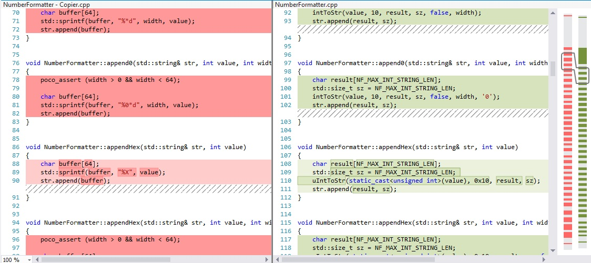
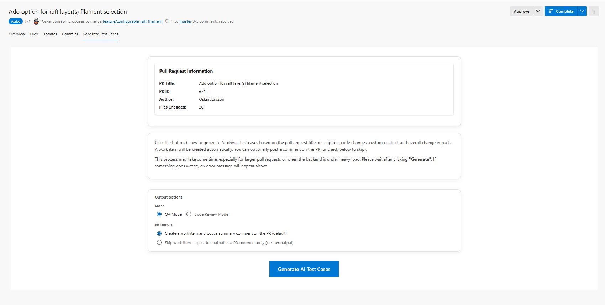
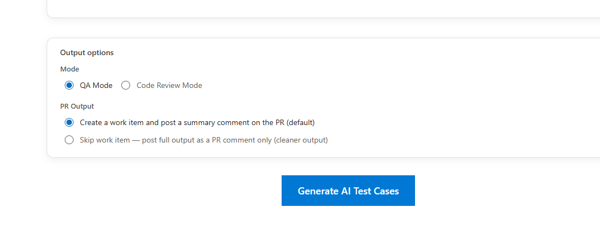
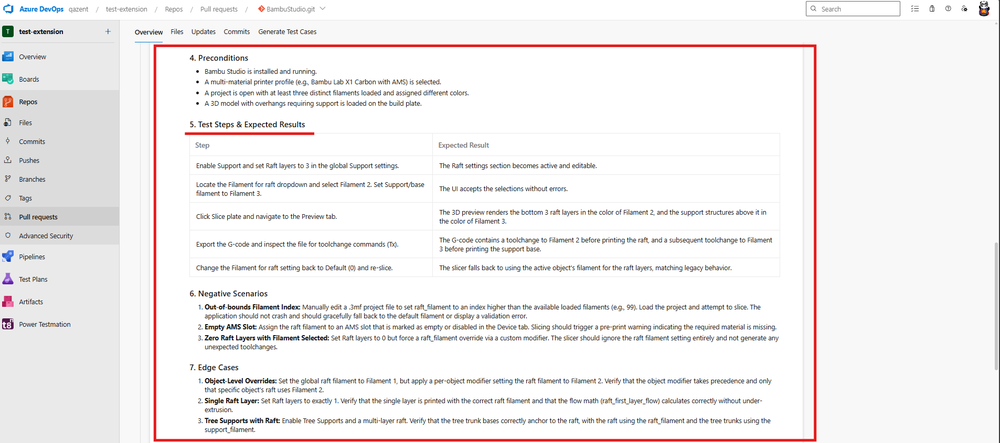
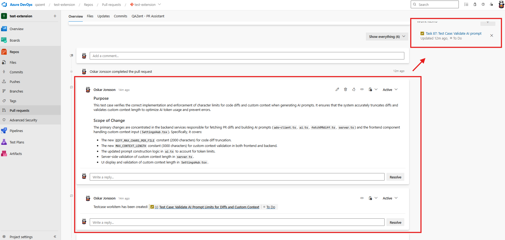
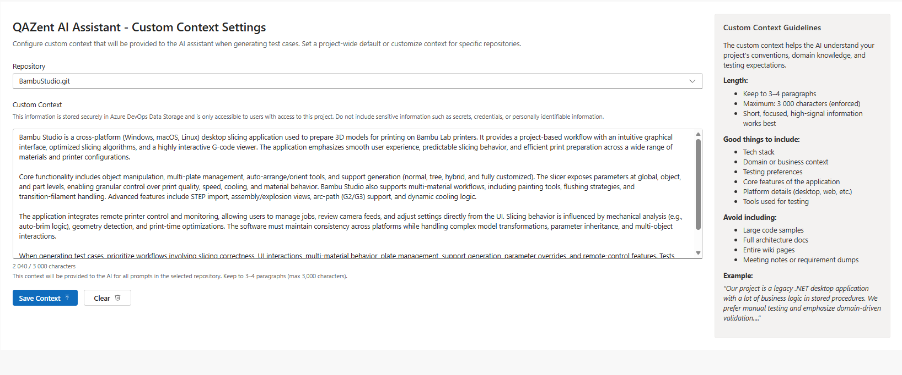
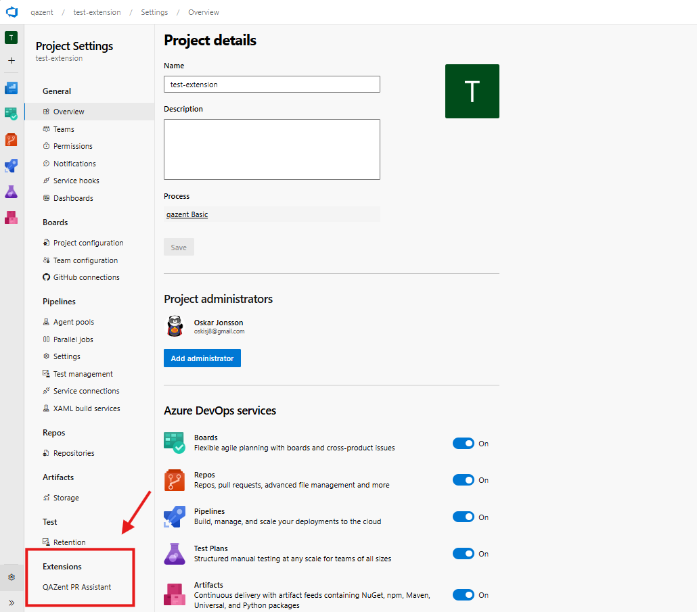

# PR Assistant – AI‑Powered Test Cases and PR Insights from Real Code Changes

Catch issues earlier, understand pull requests faster, and automate the repetitive parts of your Azure DevOps workflow. PR Assistant inspects PRs, generates reliable test cases, surfaces PR insights, and automates work items directly inside Azure DevOps — helping development and QA teams move faster reviews, stronger coverage, and quicker feedback loops. Level up your confirmation and shift-left testing!

View https://qazent.com for more info!

## Key Features

- **QA Mode and Code Review Mode** – Switch between structured test-case generation and actionable code review summaries, so the same extension fits QA and engineering workflows
- **Flexible PR output** – Choose work item plus summary PR comment (default), or post the full output as a PR comment only — mutually exclusive options prevent conflicting settings
- **AI‑powered analysis from real diffs** – Powered by Google Gemini 3.1 Pro (preview) to analyze code changes, PR metadata, and commit messages
- **PR commit messages in context** – Commit history is included alongside the diff so generated output reflects how the change evolved
- **Instant work item creation** – Convert pull requests into Azure DevOps work items with traceable links back to the PR
- **An AI that truly knows your project** – Project default and repository-specific custom context help the AI apply the same signals your QA team would use
- **Structured documentation** – QA mode: purpose, scope, preconditions, steps, edge cases, and regression areas; Code Review mode: findings, risk areas, and an overall verdict
- **14‑day free trial** – Full functionality per organization; licensing and checkout via [qazent.com](https://qazent.com) (Lemon Squeezy)
- **Privacy‑first processing** – Sends only PR diffs, metadata, and commit messages needed for analysis; data is processed in memory and not used to train AI models

## How It Works

**QA mode**

**Code Review mode**

1. **Pull request detected**

   Open any pull request in Azure Repos and go to the **Analyze PR** tab. QAZent captures the PR and loads your Project Default Context or repository-specific custom context when configured.

   

   

2. **Choose QA mode or Code Review mode**

   Select the mode that fits your workflow, then pick how results should be delivered on the PR.

   

3. **Deep diff analysis**

   Click **Analyze**. The engine inspects added, removed, and modified lines — plus PR title, description, linked work items, and commit messages — to understand intent, risk, and behavioral impact.

   **QA mode** produces structured output such as:

   - Purpose and scope of the PR
   - Preconditions required before testing
   - Detailed test steps with expected results
   - Negative scenarios and edge cases
   - Regression areas to verify
   - Data requirements and automation notes

   **Code Review mode** produces a structured review summary with actionable findings, highest-risk areas, and an overall verdict (approve / approve with comments / request changes).

4. **Work item or PR comment created**

   Depending on your output choice:

   - **Default:** Create an Azure DevOps work item and post a summary comment on the PR
   - **Alternate:** Skip the work item and post the full output as a PR comment only

   PR Assistant does not modify your pull request code automatically — all output is reviewable before you act on it.

   

   

   

   

5. **Give the AI the context a QA engineer would use (recommended)**

   Configure **Project Default Context** for org-wide rules and **Repository Custom Context** where a repo needs extra domain nuance. Use Project context for shared standards; use Repository context when a codebase has unique conventions or risk hotspots.

   

   

   

## Quick Start

1. Install PR Assistant from the **Azure DevOps Marketplace** and go to [qazent.com](https://qazent.com)
2. Start your **14‑day free trial** (monthly plan) and activate the license under **Project Settings → QAZent - License**
3. Optionally configure **QAZent - AI Context Settings** (project and repository custom context)
4. Open a pull request, choose **QA** or **Code Review** mode, select your **PR output** option, and click **Analyze**
5. For best results, write a clear PR title, description and commit messages

For detailed setup, licensing, and FAQ, visit [qazent.com](https://qazent.com), [changelog](https://qazent.com/changelog), [FAQ](https://qazent.com/#faq), [license](https://qazent.com/license), [support](https://qazent.com/support)

## What the AI Takes Into Consideration

PR Assistant generates high-quality, context-aware output by combining several inputs from your pull request and project environment:

### Pull request metadata

- PR title and description
- Commit messages
- Linked work items (if any)

### Code diff (diff-level access)

- Changed file names and paths
- Added, removed, and modified logic in the PR diff
- Token-bounded diff detail so analysis stays focused on what changed 
- Specific file names, file paths, file extensions give extra points into our internal ranking system for the AI. 
This enables the AI to focus on important files instead of several irrelevant markdown files. File paths is taking into consideration. For example, src, core, app, application folders ranks higher than others. And, .cs, .cpp ranks higher than .md and .txt 
- Large refactors is ranked higher than small refactors

Analysis uses **diff-level data only** — not full-repository or whole-file reads beyond what is required to build the PR diff.

### PR commit messages

- Commit messages from the PR history (capped for prompt size)
- Helps the AI understand incremental intent behind the change set

### Optional: custom context

- Project default context (shared across repositories)
- Repository-specific context (overrides or extends project defaults)
- Business rules, architecture patterns, testing conventions, and domain terminology

### What we do not do

- **No silent PR changes** – Generated content is for review; PR Assistant does not edit your code or merge changes on your behalf
- **No permanent storage of PR content** – Diffs, descriptions, and custom context are processed ephemerally for generation and then discarded
- **No training on your data** – Customer data is not used by QAZent for model training; Gemini API usage follows Google's API terms for non-training use

For full details, see the extension [privacy policy](privacy-policy.md) and [qazent.com/privacy](https://qazent.com/privacy).

## Why PR Assistant

- **Azure DevOps–native** — Works directly inside Azure Repos pull requests 
- **QA‑first, with optional code review** — Structured test coverage with a review mode you can use when needed  
- **Fastest setup on the market** — Live in ~5 minutes. No custom pipelines, no elevated permissions, no service accounts, no YAML  
- **Diff‑only data access** — Only reads PR diffs, metadata, and commit messages — never your full source tree  
- **Simple, flat, transparent pricing**  
- **We host all AI infrastructure** — Zero cloud‑cost anxiety, 
- **Minimal codebase access required** — Competitors require write and manage code permissions; we don’t  
- **Fully in‑memory, stateless flow** — A design that makes the extension one of the most secure options available  

Learn more: [QAZent vs CodeRabbit](https://qazent.com/comparisons/coderabbit)

## Benefits

- **Faster PR reviews** – Clear PR insights and optional Code Review mode for engineering teams
- **Agile, streamlined testing** – Automatic work item creation with detailed, consistent structure
- **Stronger quality** – Catch edge cases and regression areas before changes reach production
- **Save time** – Automate test-case documentation and review summaries from real code diffs
- **Maintain consistency** – Every PR can follow the same structured QA or review approach
- **Enable traceability** – Link work items and comments directly to the pull request under review
- **Shift-left testing** 

**Publisher:** QAZent\
**Categories:** Azure Repos, Azure Boards\
**Website:** https://qazent.com\
**Changelog:** https://qazent.com/changelog\
**FAQ:** https://qazent.com/#faq
