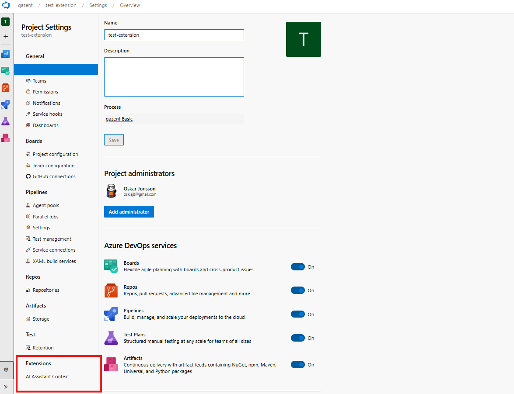
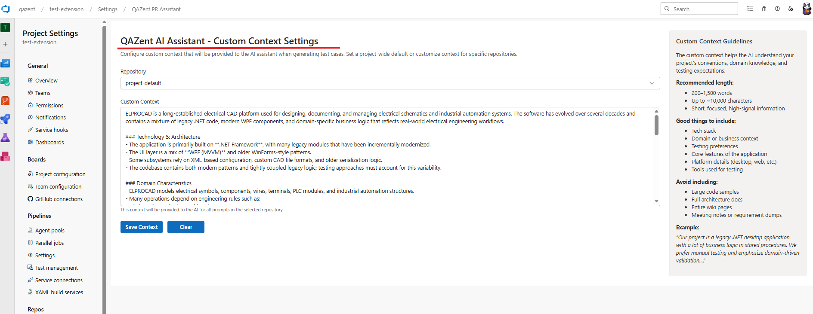
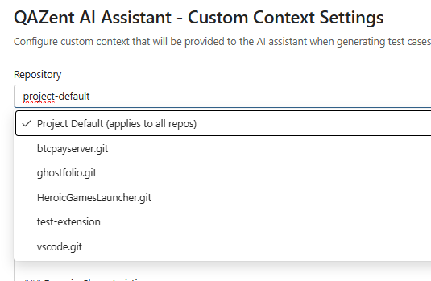
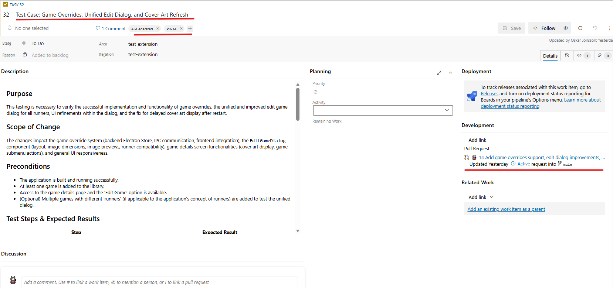
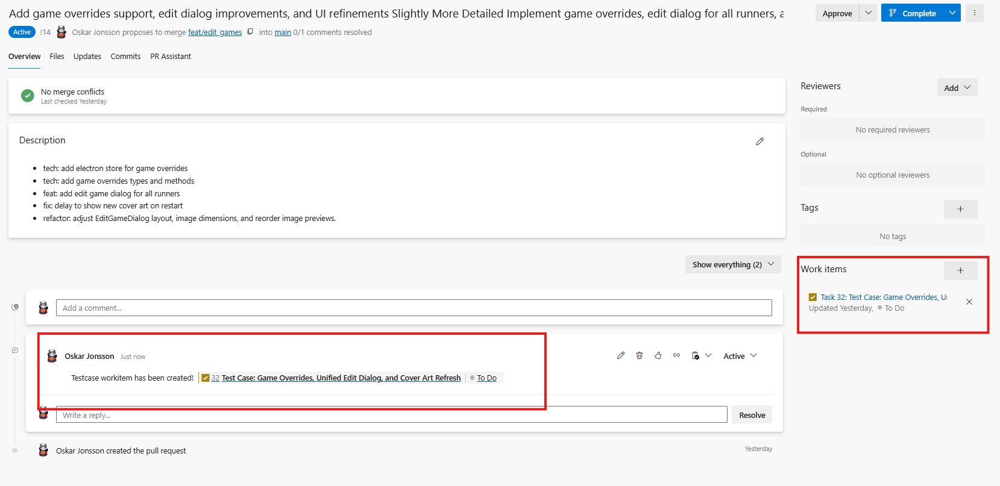

# PR Assistant - AI-Powered Test Case Generation

Transform your pull request workflow with AI-powered test case generation that ensures comprehensive testing coverage. PR Assistant analyzes your code changes and automatically generates structured, thorough test cases, helping development and QA teams maintain high quality standards.

## Key Features

- **AI-Powered Test Case Generation** - Leverages Google Gemini to analyze code changes and generate comprehensive test cases automatically
- **Seamless Azure DevOps Integration** - Adds a dedicated PR Assistant tab directly within your pull request interface
- **Instant Work Item Creation** - Convert generated test cases into Azure DevOps Test Case work items instantly
- **Structured Test Documentation** - Produces complete test cases with preconditions, test steps, and expected results
- **Enhanced Test Coverage** - Ensures thorough testing by identifying edge cases and scenarios you might miss

## How It Works

1. **Open a Pull Request** - Navigate to any pull request in Azure Repos
2. **Create Work Items** -   Instant creation of workitems with the following content
    Purpose of the PR
    Scope of Change 
    Preconditions to have before test 
    Detailed and comprehensive test steps along with expected results 
    Negative scenarios
    Edge cases
    Regression Areas
    Data Requirements
    Automation Notes - Suggestion on how to automate this testcase, and how, with which tools
3. **OPTIONAL: Input Custom Context** - To help the AI, and introduce the codebase and business domain.

## Prerequisites

Before installing PR Assistant, ensure you have:

- **Azure DevOps Organization** - Active Azure DevOps account with appropriate permissions

## Quick Start

1. Install the PR Assistant extension from the Azure DevOps Marketplace
2. Configure custom context for project and repositories (if multiple)
3. Open a pull request. (for best result, document clearly in the PR's title and message)

For detailed setup instructions, visit the [full documentation](EXTENSION_README.md).

## Benefits
- **Agile and Streamlined Testing** - Automatic workitem creation with detailed information
- **Improve Quality** - Generate comprehensive test cases that catch issues before they reach production
- **Save Time** - Automate the tedious process of writing test case documentation
- **Maintain Consistency** - Ensure all PRs follow the same structured testing approach
- **Enable Traceability** - Link test cases directly to code changes for better audit trails

## Support

Need help or found an issue?

- **Issues** - Report bugs or request features on the Q&A page

---

**Publisher**: QAZent
**Version**: 1.2.4
**Category**: Azure Repos
